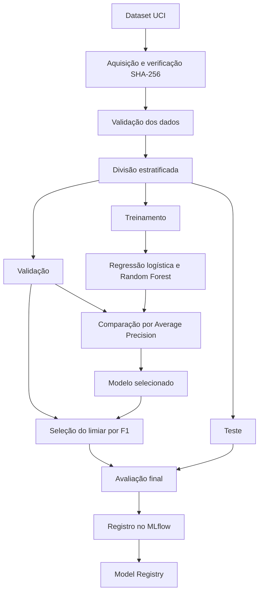

# E-commerce Purchase Propensity MLOps

Pipeline de Machine Learning para estimar a probabilidade de uma sessão de e-commerce resultar em compra, utilizando dados comportamentais de navegação.

O projeto aplica práticas de Engenharia de Machine Learning para construir uma solução reproduzível, auditável, testável e preparada para evolução até produção.


## Identificação

- **Instituição:** FIAP
- **Curso:** Pós-Tech Machine Learning Engineering
- **Tech Challenge:** Fase 2
- **Grupo:** 24
- **Autora:** Bianca Firmino Ferreira de Sena
- **Repositório:** `ecommerce-purchase-propensity-mlops`


## Problema de negócio

Uma empresa de e-commerce precisa identificar quais sessões de navegação apresentam maior propensão de compra.

A previsão pode apoiar:

- priorização de campanhas e ofertas;
- personalização da experiência;
- redução de abordagens pouco eficientes;
- melhor utilização do orçamento de marketing;
- definição de thresholds alinhados ao valor de negócio.

O projeto trata o problema como uma classificação binária:

- `Revenue = True`: a sessão terminou em compra;
- `Revenue = False`: a sessão não terminou em compra.


## Objetivos técnicos

A solução está sendo desenvolvida com foco em:

- código modular e tipado;
- prevenção de vazamento de dados;
- gerenciamento de dependências com Poetry;
- versionamento de dados e pipelines com DVC;
- validação de dados com Pandera;
- engenharia de atributos aplicada dentro do pipeline;
- treinamento reproduzível de modelos;
- experimentos e métricas rastreados com MLflow;
- registro e promoção de modelos;
- seleção de threshold exclusivamente na validação;
- avaliação final em conjunto de teste isolado;
- testes automatizados;
- containerização com Docker;
- API de inferência com FastAPI;
- monitoramento e análise de drift;
- decisões de classificação orientadas ao negócio.

## Dataset

O projeto utiliza o [Online Shoppers Purchasing Intention Dataset](https://archive.ics.uci.edu/dataset/468/online+shoppers+purchasing+intention+dataset), disponibilizado pelo UCI Machine Learning Repository.

Principais características:

| Característica | Valor |
|---|---:|
| Registros | 12.330 |
| Variáveis preditoras | 17 |
| Variável-alvo | `Revenue` |
| Sessões sem compra | 10.422 |
| Sessões com compra | 1.908 |
| Taxa de compra | 15,47% |
| Valores ausentes | 0 |

O desbalanceamento da variável-alvo é considerado na configuração do modelo, na escolha das métricas e na definição do threshold de decisão.


### Integridade dos dados

O arquivo original é validado por SHA-256:

```text
b3055ee355f59134d851d32641183cb4a8b45def7124d2f50442a042f358e0d9
```

A aquisição automatizada rejeita arquivos alterados ou incompatíveis com o conteúdo oficial esperado.


## Arquitetura do pipeline



A separação é determinística, utiliza a semente `42` e preserva a proporção da classe positiva:

| Partição | Registros | Taxa de compra |
|---|---:|---:|
| Treino | 8.631 | 15,48% |
| Validação | 1.849 | 15,47% |
| Teste | 1.850 | 15,46% |

O conjunto de teste permanece isolado durante o treinamento e a seleção do threshold. Ele é utilizado somente para a avaliação final do modelo.


## Pipeline DVC

O pipeline contém cinco etapas:

| Etapa | Responsabilidade |
|---|---|
| `validate_data` | Valida o schema, os domínios e a qualidade dos dados brutos. |
| `preprocess` | Divide os dados em treinamento, validação e teste e salva as partições em Parquet. |
| `train_baseline` | Treina a regressão logística e calcula suas métricas na validação. |
| `compare_models` | Compara regressão logística e Random Forest pela Average Precision na validação e salva o modelo selecionado. |
| `evaluate_selected_model` | Seleciona o limiar pela maximização do F1 na validação e avalia o modelo selecionado no teste. |

O pré-processamento de cada candidato é ajustado exclusivamente com os dados de treinamento. A seleção do modelo e do limiar utiliza a validação. O teste é reservado à avaliação final.

O registro no MLflow é executado separadamente, após a conclusão do pipeline DVC.


### Visualização das dependências

```bash
poetry run dvc dag
```

### Listagem das etapas

```bash
poetry run dvc stage list
```

### Reprodução do pipeline

```bash
poetry run dvc repro
```

O DVC utiliza as dependências, os parâmetros e o `dvc.lock` para identificar quais etapas precisam ser executadas novamente.


### Reprodução sem remoto DVC

O projeto não possui um armazenamento remoto DVC configurado. Para reproduzir o pipeline após clonar o repositório e instalar as dependências, baixe o dataset público e execute:

```bash
poetry run python -m purchase_propensity.data.download
poetry run dvc repro
```

A aquisição verifica a integridade do arquivo. Esse procedimento foi testado em uma cópia limpa do repositório no macOS.

Para executar novamente a avaliação do modelo selecionado:

```bash
poetry run dvc repro --force --single-item evaluate_selected_model
```


### Consulta do estado

```bash
poetry run dvc status
```

### Consulta das métricas

```bash
poetry run dvc metrics show
```


## Estratégia de modelagem

São comparados dois candidatos: regressão logística e Random Forest.

A regressão logística funciona como referência inicial por sua simplicidade e eficiência. O Random Forest permite representar relações não lineares e interações entre características.


### Configurações dos candidatos

| Parâmetro | Regressão logística | Random Forest |
|---|---|---|
| Peso das classes | `None` | `None` |
| Semente aleatória | 42 | 42 |
| Solver | `lbfgs` | Não se aplica |
| Máximo de iterações | 2.000 | Não se aplica |
| Quantidade de árvores | Não se aplica | 300 |
| Profundidade máxima | Não se aplica | 12 |
| Mínimo de amostras por folha | Não se aplica | 5 |

As configurações são centralizadas em `params.yaml`.


### Seleção do modelo e do limiar

O modelo é selecionado pela maior Average Precision no conjunto de validação.

Após a seleção, o limiar de classificação é escolhido pela maximização do F1 na validação. Esse limiar é aplicado ao teste sem novo ajuste.

O F1 orienta esta avaliação experimental. A adoção de um limiar operacional dependerá dos custos de falsos positivos e falsos negativos e das restrições do negócio.


## Engenharia de atributos e prevenção de vazamento

A modelagem utiliza 16 características: nove numéricas e sete categóricas.

A variável `PageValues` foi excluída por precaução, pois sua construção e disponibilidade no momento da previsão ainda precisam ser verificadas. Sua associação com a compra, isoladamente, não comprova vazamento de informação.

As transformações são encapsuladas em um `Pipeline` do Scikit-Learn.

| Tratamento | Regressão logística | Random Forest |
|---|---|---|
| Ausentes numéricos | Imputação pela mediana | Imputação pela mediana |
| Escalonamento numérico | `StandardScaler` | Sem escalonamento |
| Ausentes categóricos | Imputação pela categoria mais frequente | Imputação pela categoria mais frequente |
| Codificação categórica | `OneHotEncoder` | `OneHotEncoder` |
| Categorias desconhecidas | Ignoradas pelo codificador | Ignoradas pelo codificador |

Não foram identificados valores ausentes nos dados analisados. Os imputadores integram o pipeline como tratamento explícito para eventuais ausências.

Os códigos de sistema operacional, navegador, região e tipo de tráfego são tratados como categorias.

Os imputadores, o escalonador e o codificador são ajustados exclusivamente no treinamento. As transformações aprendidas são aplicadas à validação, ao teste e à inferência.

As características descrevem a navegação da sessão. Seu uso durante uma sessão em andamento exige definir o instante da previsão e verificar quais informações estarão disponíveis.

Foram observadas combinações de características compartilhadas entre as partições. Os registros foram preservados, pois perfis iguais não comprovam que representam a mesma sessão. Essa sobreposição permanece documentada como limitação da avaliação.


## Resultados da modelagem

A regressão logística e o Random Forest foram treinados com as mesmas partições. A escolha do modelo foi baseada na Average Precision do conjunto de validação.


### Comparação na validação

| Modelo | Average Precision |
|---|---:|
| Regressão logística | 0,3200 |
| Random Forest | 0,3493 |

O Random Forest apresentou a maior Average Precision na validação e foi selecionado para a avaliação final.


### Limiar de classificação

Após a escolha do modelo, o limiar foi selecionado pela maximização do F1 na validação:

| Informação | Resultado |
|---|---:|
| Limiar selecionado | 0,1806 |
| F1 na validação | 0,4097 |

O limiar completo é `0.18057002545820874`. Ele é aplicado às probabilidades de compra para definir a classe prevista:

- probabilidade maior ou igual ao limiar: **com compra**;
- probabilidade abaixo do limiar: **sem compra**.


### Avaliação final no teste

| Métrica | Resultado |
|---|---:|
| Average Precision | 0,3786 |
| F1 | 0,4254 |
| Precisão | 0,2989 |
| Recall | 0,7378 |


### Matriz de confusão no teste

| Resultado | Quantidade de sessões |
|---|---:|
| Verdadeiros negativos | 1.069 |
| Falsos positivos | 495 |
| Falsos negativos | 75 |
| Verdadeiros positivos | 211 |

O recall de aproximadamente 73,78% indica que o modelo identificou 211 das 286 sessões com compra no teste. Ao mesmo tempo, 495 sessões sem compra foram classificadas como compra.

A escolha de um limiar para uso operacional deve considerar o custo dessas classificações e os objetivos do negócio.


### Relatórios e visualizações

Os resultados completos da execução local estão disponíveis em:

- `reports/metrics/model_comparison.json`
- `reports/metrics/selected_model_test_metrics.json`
- `reports/figures/selected_model/`

Os resultados da execução em Docker estão documentados na seção **Execução com Docker**.


## Rastreamento com MLflow

O MLflow registra os parâmetros, as métricas, a linhagem dos dados e os artefatos da execução. O modelo selecionado é armazenado no Model Registry, com o limiar de classificação
documentado nos parâmetros e nas tags da versão.

O registro é executado separadamente após o pipeline DVC.


### Configuração local

Crie o arquivo de ambiente, caso ainda não exista:

```bash
cp .env.example .env
```

Configure a URI do MLflow no `.env` para corresponder à porta do servidor utilizado. Na execução documentada, usamos:

```text
http://127.0.0.1:5001
```

Na raiz do projeto, inicie o servidor:

```bash
poetry run mlflow server \
  --backend-store-uri sqlite:///mlruns/mlflow.db \
  --host 127.0.0.1 \
  --port 5001
```

Deixe o servidor em execução e abra a interface:

```text
http://127.0.0.1:5001
```


### Rastreamento dos candidatos

Com o servidor MLflow em execução, a comparação pode registrar cada candidato, seus parâmetros, suas métricas de validação e o pipeline treinado:

```bash
poetry run python -m purchase_propensity.modeling.compare \
  --track-mlflow
```

Esse comando também gera o modelo selecionado e o relatório nos caminhos padrão da comparação. Cada execução cria novas runs no experimento configurado.

O registro do modelo vencedor no Model Registry é realizado separadamente, conforme a próxima seção.


### Registro do modelo selecionado

Com o pipeline DVC concluído, execute em outro terminal:

```bash
poetry run python -m purchase_propensity.modeling.track \
  --model models/selected_model.joblib \
  --metrics reports/metrics/selected_model_test_metrics.json \
  --metrics-section test \
  --params params.yaml \
  --train data/processed/train.parquet \
  --validation data/processed/validation.parquet \
  --test data/processed/test.parquet \
  --run-name random-forest-selected-model \
  --model-family random_forest \
  --pipeline-stage evaluate_selected_model \
  --comparison-report reports/metrics/model_comparison.json
```

Esse comando documenta a execução em que o Random Forest foi selecionado. Se outro candidato vencer em uma nova execução, ajuste `--model-family` e `--run-name` de acordo com o relatório
`reports/metrics/model_comparison.json`.


### Registro da execução documentada

| Informação | Valor |
|---|---|
| Experimento | `ecommerce-purchase-propensity` |
| Modelo | `purchase-propensity-classifier` |
| Versão registrada | `2` |
| Alias atribuído | `champion` |
| Limiar registrado | `0.18057002545820874` |

A versão indicada corresponde à execução local documentada. Novos registros podem criar outras versões e atualizar o alias configurado.

O limiar fica registrado como metadado. Para produzir a classe com esse valor, a aplicação de inferência deve obter a probabilidade e aplicar explicitamente a regra `probabilidade >= limiar`; o método `predict()` do modelo não passa a utilizar o limiar registrado automaticamente.

O banco, os artefatos locais e o arquivo `.env` permanecem fora do Git.


## Execução com Docker

A imagem utiliza Python 3.11.16, Poetry 2.4.0 e as dependências registradas no `poetry.lock`, incluindo o DVC.

Os dados são montados somente para leitura. Modelos, relatórios e gráficos são persistidos em diretórios locais por volumes.


### Construção da imagem

Na raiz do projeto, com o Docker Desktop em execução:

```bash
docker build -t purchase-propensity:local .
```

Verifique a inicialização da aplicação:

```bash
docker run --rm purchase-propensity:local
```

O comando apresenta a ajuda do módulo de treinamento.


### Preparação dos diretórios

Os arquivos de treinamento, validação e teste devem estar disponíveis em `data/processed/`. Para gerá-los no ambiente local:

```bash
poetry run dvc repro preprocess
```

Crie os diretórios de saída:

```bash
mkdir -p models/docker reports/metrics/docker reports/figures/docker
```

### Comparação dos modelos

```bash
docker run --rm \
  --mount "type=bind,source=$(pwd)/data/processed,target=/app/data/processed,readonly" \
  --mount "type=bind,source=$(pwd)/models/docker,target=/app/models/docker" \
  --mount "type=bind,source=$(pwd)/reports/metrics/docker,target=/app/reports/metrics/docker" \
  purchase-propensity:local \
  python -m purchase_propensity.modeling.compare \
  --train data/processed/train.parquet \
  --validation data/processed/validation.parquet \
  --params params.yaml \
  --model-output models/docker/selected_model.joblib \
  --report-output reports/metrics/docker/model_comparison.json
```

A comparação seleciona o modelo pela maior Average Precision
no conjunto de validação.


### Avaliação do modelo selecionado

```bash
docker run --rm \
  --mount "type=bind,source=$(pwd)/data/processed,target=/app/data/processed,readonly" \
  --mount "type=bind,source=$(pwd)/models/docker,target=/app/models/docker,readonly" \
  --mount "type=bind,source=$(pwd)/reports/metrics/docker,target=/app/reports/metrics/docker" \
  --mount "type=bind,source=$(pwd)/reports/figures/docker,target=/app/reports/figures/docker" \
  purchase-propensity:local \
  python -m purchase_propensity.modeling.evaluate \
  --model-name selected_model \
  --model models/docker/selected_model.joblib \
  --validation data/processed/validation.parquet \
  --test data/processed/test.parquet \
  --params params.yaml \
  --report reports/metrics/docker/selected_model_test_metrics.json \
  --figures-directory reports/figures/docker/selected_model
```

O limiar de classificação é escolhido pela maximização do F1 na validação e aplicado ao teste sem novo ajuste.


### Pipeline DVC completo no contêiner

Construa a imagem:

```bash
docker build -t purchase-propensity:dvc .
```

Execute a aquisição do dataset e as etapas do pipeline:

```bash
docker run --rm purchase-propensity:dvc \
  sh -c '
    python -m purchase_propensity.data.download &&
    dvc repro --force
  '
```

Essa execução usa um contêiner temporário. Para preservar os arquivos gerados, é necessário configurar volumes.

O registro dos candidatos no MLflow é executado separadamente com a opção `--track-mlflow`.


### Resultados observados

| Resultado | macOS ARM64 | Docker Linux ARM64 |
|---|---:|---:|
| Modelo selecionado | Random Forest | Random Forest |
| Average Precision na validação | 0,3493 | 0,3482 |
| Limiar escolhido na validação | 0,1806 | 0,1848 |
| Average Precision no teste | 0,3786 | 0,3793 |
| F1 no teste | 0,4254 | 0,4229 |

Os valores da tabela estão arredondados. Os relatórios JSON preservam a precisão dos resultados.

Foram verificados os mesmos arquivos de dados, código, parâmetros e versões de Python, NumPy, Pandas, Scikit-Learn, SciPy e Joblib nos dois ambientes.

Duas execuções da comparação dentro do Docker produziram relatórios idênticos. Foram observadas pequenas diferenças entre macOS e Linux; sua causa não foi isolada. Portanto, não se afirma equivalência numérica exata entre plataformas.


### Artefatos produzidos

- Modelo: `models/docker/selected_model.joblib`
- Comparação: `reports/metrics/docker/model_comparison.json`
- Avaliação: `reports/metrics/docker/selected_model_test_metrics.json`
- Gráficos: `reports/figures/docker/selected_model/`

Os modelos binários permanecem fora do Git. Os relatórios e gráficos documentam a execução.

Os módulos Python e o pipeline DVC podem ser executados dentro do contêiner. O rastreamento dos candidatos e o registro do modelo no MLflow foram validados separadamente no ambiente local.


## Execução manual

Os comandos abaixo devem ser executados na raiz do projeto, com as dependências instaladas pelo Poetry.


### Aquisição dos dados

```bash
poetry run python -m purchase_propensity.data.download
```

O arquivo bruto é validado por SHA-256.


### Validação dos dados

```bash
poetry run python -m purchase_propensity.data.validate
```

Relatório produzido:

```text
reports/metrics/raw_data_validation.json
```


### Pré-processamento

```bash
poetry run python -m purchase_propensity.data.preprocess
```

Partições produzidas:

```text
data/processed/train.parquet
data/processed/validation.parquet
data/processed/test.parquet
```


### Treinamento da regressão logística

```bash
poetry run python -m purchase_propensity.modeling.train
```

Artefatos produzidos:

```text
models/baseline_logistic_regression.joblib
reports/metrics/baseline_validation_metrics.json
```

### Comparação dos candidatos

```bash
poetry run python -m purchase_propensity.modeling.compare
```

A comparação treina regressão logística e Random Forest, seleciona o candidato pela Average Precision na validação e produz:

```text
models/selected_model.joblib
reports/metrics/model_comparison.json
```


### Avaliação do modelo selecionado

```bash
poetry run python -m purchase_propensity.modeling.evaluate \
  --model-name selected_model \
  --model models/selected_model.joblib \
  --report reports/metrics/selected_model_test_metrics.json \
  --figures-directory reports/figures/selected_model
```

A avaliação seleciona o limiar na validação e o aplica ao teste. Os resultados são salvos em:

```text
reports/metrics/selected_model_test_metrics.json
reports/figures/selected_model/
```

O registro no MLflow é realizado em uma etapa separada, conforme a seção **Rastreamento com MLflow**.


## Estrutura do projeto

```text
.
├── .github/
│   └── workflows/
├── configs/
├── data/
│   ├── raw/
│   ├── interim/
│   └── processed/
├── docs/
│   └── decisions/
├── models/
├── notebooks/
├── reports/
│   ├── figures/
│   │   └── baseline/
│   └── metrics/
├── src/
│   └── purchase_propensity/
│       ├── api/
│       ├── data/
│       ├── features/
│       ├── modeling/
│       ├── pipelines/
│       └── config.py
├── tests/
│   ├── fixtures/
│   ├── integration/
│   └── unit/
├── Dockerfile
├── dvc.lock
├── dvc.yaml
├── params.yaml
├── poetry.lock
└── pyproject.toml
```


## Requisitos

- Python 3.11
- Poetry 2.x
- Git
- DVC
- Docker


## Instalação

Clone o repositório:

```bash
git clone https://github.com/biancafsena/ecommerce-purchase-propensity-mlops.git
cd ecommerce-purchase-propensity-mlops
```

Configure o ambiente virtual dentro do projeto:

```bash
poetry config virtualenvs.in-project true --local
poetry env use python3.11
```

Instale as dependências:

```bash
poetry install
```

Confirme o ambiente:

```bash
poetry run python --version
poetry check
```


## Qualidade de código

Formatação:

```bash
poetry run ruff format src tests
```

Análise estática:

```bash
poetry run ruff check src tests
```

Verificação de tipos:

```bash
poetry run mypy src
```

Testes e cobertura:

```bash
poetry run pytest
```

Execução completa dos hooks:

```bash
poetry run pre-commit run --all-files
```

Estado da última verificação local:

- 107 testes automatizados aprovados;
- 87,28% de cobertura total;
- cobertura mínima configurada de 80%;
- Ruff e Mypy aprovados;
- hooks de pre-commit e pre-push configurados.


## Tecnologias

- Python 3.11
- Scikit-Learn
- Pandas
- NumPy
- Pandera
- Matplotlib
- Seaborn
- MLflow
- Skops
- DVC
- Poetry
- Pytest
- Ruff
- Mypy
- FastAPI
- Docker


## Princípios adotados

- Reprodutibilidade desde a origem dos dados.
- Separação clara de responsabilidades.
- Parâmetros fora do código.
- Prevenção de vazamento entre treino, validação e teste.
- Threshold selecionado sem utilizar o conjunto de teste.
- Métricas adequadas ao desbalanceamento.
- Dados pesados fora do Git.
- Rastreabilidade entre dados, código, parâmetros, experimentos e modelos.
- Validação antes do processamento.
- Artefatos e métricas auditáveis.
- Testes automatizados como requisito de entrega.


## Status e roadmap

### Implementado

- [x] Estrutura modular do projeto
- [x] Ambiente Poetry e arquivo de dependências `poetry.lock`
- [x] Configuração de qualidade de código e testes
- [x] Hooks de pre-commit e pre-push
- [x] Aquisição automatizada do dataset público
- [x] Verificação de integridade por SHA-256
- [x] Versionamento do dataset bruto com DVC
- [x] Validação de schema e dados com Pandera
- [x] Relatório de qualidade dos dados
- [x] Divisão estratificada em treinamento, validação e teste
- [x] Dados processados em formato Parquet
- [x] Pipeline de engenharia de atributos
- [x] Transformações ajustadas somente com dados de treinamento
- [x] Baseline com regressão logística
- [x] Comparação entre regressão logística e Random Forest
- [x] Seleção do modelo pela Average Precision na validação
- [x] Seleção do limiar de classificação na validação
- [x] Avaliação do modelo selecionado no conjunto de teste
- [x] Curvas e matriz de confusão
- [x] Pipeline DVC para validação, preparação, treinamento e avaliação
- [x] Rastreamento de experimento com MLflow
- [x] Registro da linhagem dos conjuntos de dados no MLflow
- [x] Registro e versionamento do modelo no MLflow Model Registry
- [x] Registro do limiar de classificação como metadado da versão
- [x] Atribuição de alias ao modelo registrado
- [x] Testes unitários das etapas implementadas
- [x] Containerização e execução dos módulos de modelagem com Docker
- [x] Teste de reprodução do pipeline em cópia limpa do repositório


### Próximas etapas para a entrega

- [ ] Revisar os requisitos e os arquivos finais do projeto
- [ ] Preparar e gravar a apresentação do Tech Challenge
- [ ] Conferir o acesso ao repositório e realizar a entrega


### Evoluções futuras

- [ ] Avaliar a calibração das probabilidades
- [ ] Desenvolver API de inferência com FastAPI
- [ ] Validar os contratos de entrada e saída da API
- [ ] Ampliar os testes de integração
- [ ] Avaliar a execução de CI com GitHub Actions
- [ ] Implementar monitoramento e simulação de drift
- [ ] Documentar as decisões arquiteturais
- [ ] Avaliar infraestrutura em nuvem
- [ ] Avaliar armazenamento remoto para os dados e artefatos do DVC


## Autora

**Bianca Firmino Ferreira de Sena**

Grupo 24 — Pós-Tech Machine Learning Engineering — FIAP.
