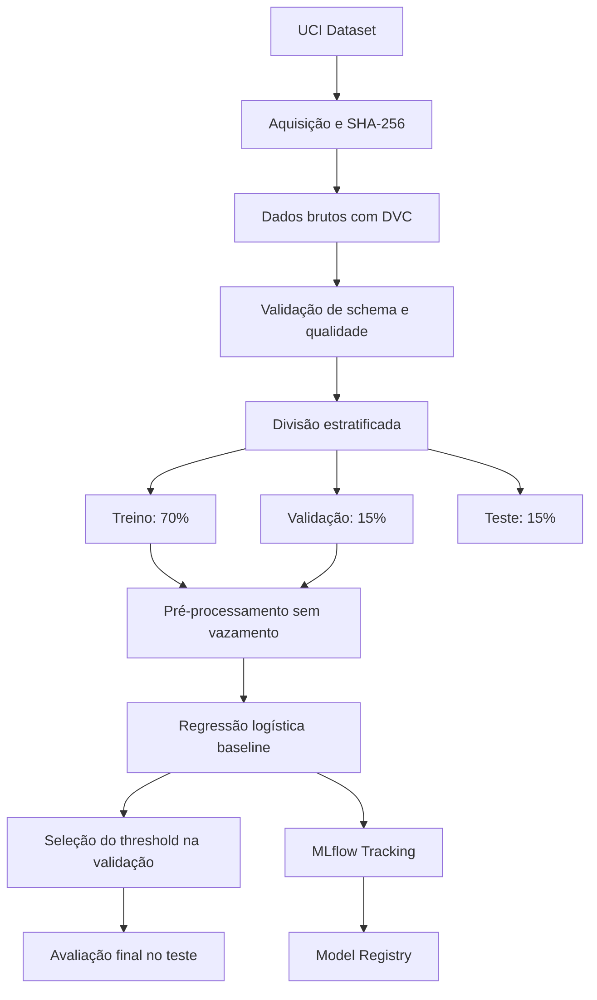

# E-commerce Purchase Propensity MLOps

Pipeline de Machine Learning para estimar a probabilidade de uma sessão de e-commerce resultar em compra, utilizando dados comportamentais de navegação.

O projeto aplica práticas de Engenharia de Machine Learning para construir uma solução reproduzível, auditável, testável e preparada para evolução até produção.

## Identificação

- **Instituição:** FIAP
- **Curso:** Pós-Tech Machine Learning Engineering
- **Tech Challenge:** Fase 2
- **Grupo:** 24
- **Autora:** Bianca Firmino Ferreira de Sena
- **Repositório:** `ecommerce-purchase-propensity-mlops`

## Problema de negócio

Uma empresa de e-commerce precisa identificar quais sessões de navegação apresentam maior propensão de compra.

A previsão pode apoiar:

- priorização de campanhas e ofertas;
- personalização da experiência;
- redução de abordagens pouco eficientes;
- melhor utilização do orçamento de marketing;
- definição de thresholds alinhados ao valor de negócio.

O projeto trata o problema como uma classificação binária:

- `Revenue = True`: a sessão terminou em compra;
- `Revenue = False`: a sessão não terminou em compra.

## Objetivos técnicos

A solução está sendo desenvolvida com foco em:

- código modular e tipado;
- prevenção de vazamento de dados;
- gerenciamento de dependências com Poetry;
- versionamento de dados e pipelines com DVC;
- validação de dados com Pandera;
- engenharia de atributos aplicada dentro do pipeline;
- treinamento reproduzível de modelos;
- experimentos e métricas rastreados com MLflow;
- registro e promoção de modelos;
- seleção de threshold exclusivamente na validação;
- avaliação final em conjunto de teste isolado;
- testes automatizados;
- containerização com Docker;
- API de inferência com FastAPI;
- monitoramento e análise de drift;
- decisões de classificação orientadas ao negócio.

## Dataset

O projeto utiliza o [Online Shoppers Purchasing Intention Dataset](https://archive.ics.uci.edu/dataset/468/online+shoppers+purchasing+intention+dataset), disponibilizado pelo UCI Machine Learning Repository.

Principais características:

| Característica | Valor |
|---|---:|
| Registros | 12.330 |
| Variáveis preditoras | 17 |
| Variável-alvo | `Revenue` |
| Sessões sem compra | 10.422 |
| Sessões com compra | 1.908 |
| Taxa de compra | 15,47% |
| Valores ausentes | 0 |

O desbalanceamento da variável-alvo é considerado na configuração do modelo, na escolha das métricas e na definição do threshold de decisão.

### Integridade dos dados

O arquivo original é validado por SHA-256:

```text
b3055ee355f59134d851d32641183cb4a8b45def7124d2f50442a042f358e0d9
```

A aquisição automatizada rejeita arquivos alterados ou incompatíveis com o conteúdo oficial esperado.

## Arquitetura do pipeline



A separação é determinística, utiliza a semente `42` e preserva a proporção da classe positiva:

| Partição | Registros | Taxa de compra |
|---|---:|---:|
| Treino | 8.631 | 15,48% |
| Validação | 1.849 | 15,47% |
| Teste | 1.850 | 15,46% |

O conjunto de teste permanece isolado durante o treinamento e a seleção do threshold. Ele é utilizado somente para a avaliação final do modelo.

## Pipeline DVC

O pipeline contém quatro etapas:

1. `validate_data`
   - valida schema, tipos, domínios e integridade;
   - verifica quantidade de registros e distribuição das classes;
   - gera um relatório JSON auditável.

2. `preprocess`
   - lê os parâmetros definidos em `params.yaml`;
   - realiza a divisão estratificada e determinística;
   - produz arquivos Parquet para treino, validação e teste.

3. `train_baseline`
   - constrói o pipeline de pré-processamento;
   - treina a regressão logística com pesos balanceados;
   - avalia o modelo na validação;
   - salva o modelo treinado e as métricas de validação.

4. `evaluate_baseline`
   - seleciona o threshold que maximiza o F1 na validação;
   - aplica o threshold selecionado ao conjunto de teste;
   - calcula métricas finais;
   - gera as curvas e a matriz de confusão.

Visualize o pipeline:

```bash
poetry run dvc dag
```

Reproduza todas as etapas:

```bash
poetry run dvc repro
```

Consulte o estado do pipeline:

```bash
poetry run dvc status
```

Consulte as métricas:

```bash
poetry run dvc metrics show
```

## Estratégia de modelagem

O baseline utiliza regressão logística por oferecer:

- interpretação simples;
- treinamento eficiente;
- probabilidades de classe;
- boa referência inicial para comparação;
- comportamento adequado em um pipeline tabular.

Configuração atual:

| Parâmetro | Valor |
|---|---|
| Modelo | Regressão logística |
| Peso das classes | `balanced` |
| Solver | `lbfgs` |
| Máximo de iterações | 1.000 |
| Semente aleatória | 42 |
| Métrica principal | Average Precision |
| Estratégia de threshold | Maximização do F1 na validação |

As configurações são centralizadas no arquivo `params.yaml`.

## Engenharia de atributos e prevenção de vazamento

As transformações são encapsuladas em um `Pipeline` do Scikit-Learn.

O pipeline aplica:

- tratamento separado para variáveis numéricas e categóricas;
- padronização das variáveis numéricas;
- codificação das variáveis categóricas;
- treinamento das transformações somente com dados de treino;
- aplicação das transformações aprendidas aos dados de validação, teste e inferência.

Essa abordagem impede que estatísticas dos conjuntos de validação ou teste influenciem o treinamento.

## Resultados do baseline

O threshold foi selecionado exclusivamente no conjunto de validação:

| Informação | Valor |
|---|---:|
| Estratégia | Maximização do F1 |
| Threshold selecionado | 0,6237 |
| F1 na validação | 0,6353 |
| F1 no teste | 0,6263 |

### Métricas finais no teste

| Métrica | Resultado |
|---|---:|
| Average Precision | 0,6181 |
| ROC AUC | 0,8987 |
| F1 | 0,6263 |
| Precisão | 0,6039 |
| Recall | 0,6503 |
| Balanced Accuracy | 0,7862 |
| Brier Score | 0,1233 |
| Log Loss | 0,4581 |
| Taxa de predições positivas | 16,65% |

### Matriz de confusão no teste

| Resultado | Quantidade |
|---|---:|
| Verdadeiros negativos | 1.442 |
| Falsos positivos | 122 |
| Falsos negativos | 100 |
| Verdadeiros positivos | 186 |

A proximidade entre as métricas de validação e teste indica comportamento consistente do baseline fora dos dados utilizados na seleção do threshold.

Os resultados completos estão disponíveis em:

```text
reports/metrics/baseline_validation_metrics.json
reports/metrics/baseline_test_metrics.json
```

As visualizações finais estão em:

```text
reports/figures/baseline/calibration_curve.png
reports/figures/baseline/confusion_matrix.png
reports/figures/baseline/precision_recall_curve.png
reports/figures/baseline/roc_curve.png
```

## Rastreamento com MLflow

O projeto utiliza MLflow para:

- registrar parâmetros;
- registrar métricas;
- armazenar artefatos;
- registrar a linhagem dos conjuntos de treino e validação;
- salvar o modelo no formato seguro `skops`;
- criar versões no Model Registry;
- atribuir o alias configurável `champion`.

### Configuração local

Crie o arquivo de ambiente:

```bash
cp .env.example .env
```

Inicie o servidor local do MLflow:

```bash
poetry run mlflow server \
  --backend-store-uri sqlite:///mlflow.db \
  --default-artifact-root ./mlartifacts \
  --host 127.0.0.1 \
  --port 5000
```

Em outro terminal, confirme a disponibilidade:

```bash
curl --fail http://127.0.0.1:5000/health
```

Registre o baseline:

```bash
poetry run python -m purchase_propensity.modeling.track
```

Abra a interface:

```bash
open http://127.0.0.1:5000
```

Configuração padrão:

| Configuração | Valor |
|---|---|
| Tracking URI | `http://127.0.0.1:5000` |
| Experimento | `ecommerce-purchase-propensity` |
| Modelo registrado | `purchase-propensity-classifier` |
| Alias de produção | `champion` |

O banco local, os artefatos e o arquivo `.env` permanecem fora do Git.

## Execução manual

### Aquisição dos dados

```bash
poetry run python -m purchase_propensity.data.download
```

Para substituir e validar novamente um arquivo existente:

```bash
poetry run python -m purchase_propensity.data.download --force
```

### Validação dos dados

```bash
poetry run python -m purchase_propensity.data.validate
```

Relatório produzido:

```text
reports/metrics/raw_data_validation.json
```

As validações incluem:

- nomes e ordem das colunas;
- tipos de dados;
- domínios categóricos;
- intervalos numéricos;
- ausência de valores nulos;
- quantidade esperada de registros;
- presença das duas classes;
- checksum do dataset.

### Pré-processamento

```bash
poetry run python -m purchase_propensity.data.preprocess
```

Arquivos produzidos:

```text
data/processed/train.parquet
data/processed/validation.parquet
data/processed/test.parquet
```

### Treinamento

```bash
poetry run python -m purchase_propensity.modeling.train
```

Artefatos produzidos:

```text
models/baseline_logistic_regression.joblib
reports/metrics/baseline_validation_metrics.json
```

### Avaliação final

```bash
poetry run python -m purchase_propensity.modeling.evaluate
```

Artefatos produzidos:

```text
reports/metrics/baseline_test_metrics.json
reports/figures/baseline/
```

## Estrutura do projeto

```text
.
├── .github/
│   └── workflows/
├── configs/
├── data/
│   ├── raw/
│   ├── interim/
│   └── processed/
├── docs/
│   └── decisions/
├── models/
├── notebooks/
├── reports/
│   ├── figures/
│   │   └── baseline/
│   └── metrics/
├── src/
│   └── purchase_propensity/
│       ├── api/
│       ├── data/
│       ├── features/
│       ├── modeling/
│       ├── pipelines/
│       └── config.py
├── tests/
│   ├── fixtures/
│   ├── integration/
│   └── unit/
├── dvc.lock
├── dvc.yaml
├── params.yaml
├── poetry.lock
└── pyproject.toml
```

## Requisitos

- Python 3.11
- Poetry 2.x
- Git
- DVC
- Docker

## Instalação

Clone o repositório:

```bash
git clone https://github.com/biancafsena/ecommerce-purchase-propensity-mlops.git
cd ecommerce-purchase-propensity-mlops
```

Configure o ambiente virtual dentro do projeto:

```bash
poetry config virtualenvs.in-project true --local
poetry env use python3.11
```

Instale as dependências:

```bash
poetry install
```

Confirme o ambiente:

```bash
poetry run python --version
poetry check
```

## Qualidade de código

Formatação:

```bash
poetry run ruff format src tests
```

Análise estática:

```bash
poetry run ruff check src tests
```

Verificação de tipos:

```bash
poetry run mypy src
```

Testes e cobertura:

```bash
poetry run pytest
```

Execução completa dos hooks:

```bash
poetry run pre-commit run --all-files
```

Estado atual de qualidade:

- 73 testes automatizados aprovados;
- 88,42% de cobertura total;
- cobertura mínima obrigatória de 80%;
- Ruff aprovado;
- Mypy aprovado;
- hooks de pre-commit e pre-push configurados.

## Tecnologias

- Python 3.11
- Scikit-Learn
- Pandas
- NumPy
- Pandera
- Matplotlib
- Seaborn
- MLflow
- Skops
- DVC
- Poetry
- Pytest
- Ruff
- Mypy
- FastAPI
- Docker

## Princípios adotados

- Reprodutibilidade desde a origem dos dados.
- Separação clara de responsabilidades.
- Parâmetros fora do código.
- Prevenção de vazamento entre treino, validação e teste.
- Threshold selecionado sem utilizar o conjunto de teste.
- Métricas adequadas ao desbalanceamento.
- Dados pesados fora do Git.
- Rastreabilidade entre dados, código, parâmetros, experimentos e modelos.
- Validação antes do processamento.
- Artefatos e métricas auditáveis.
- Testes automatizados como requisito de entrega.

## Status e roadmap

### Implementado

- [x] Estrutura modular do projeto
- [x] Ambiente Poetry e lock file
- [x] Configuração de qualidade e testes
- [x] Hooks de pre-commit e pre-push
- [x] Aquisição automatizada do dataset
- [x] Verificação de integridade por SHA-256
- [x] Versionamento do dataset bruto com DVC
- [x] Validação de schema com Pandera
- [x] Relatório auditável de qualidade
- [x] Pipeline DVC de validação
- [x] Divisão estratificada e reproduzível
- [x] Dados processados em formato Parquet
- [x] Pipeline de engenharia de atributos
- [x] Pré-processamento sem vazamento de dados
- [x] Baseline com regressão logística
- [x] Métricas adequadas ao desbalanceamento
- [x] Seleção de threshold na validação
- [x] Avaliação final no conjunto de teste
- [x] Curvas e matriz de confusão
- [x] Rastreamento de experimentos com MLflow
- [x] Linhagem dos conjuntos de dados no MLflow
- [x] MLflow Model Registry
- [x] Versionamento e alias de modelo
- [x] Testes unitários das etapas implementadas

### Próximas etapas

- [ ] Comparação entre modelos
- [ ] Calibração de probabilidades
- [ ] API de inferência com FastAPI
- [ ] Validação dos contratos de entrada e saída da API
- [ ] Testes de integração
- [ ] Containerização com Docker
- [ ] CI com GitHub Actions
- [ ] Monitoramento e simulação de drift
- [ ] Documentação das decisões arquiteturais
- [ ] Avaliação de infraestrutura em nuvem

## Autora

**Bianca Firmino Ferreira de Sena**

Grupo 24 — Pós-Tech Machine Learning Engineering — FIAP.
