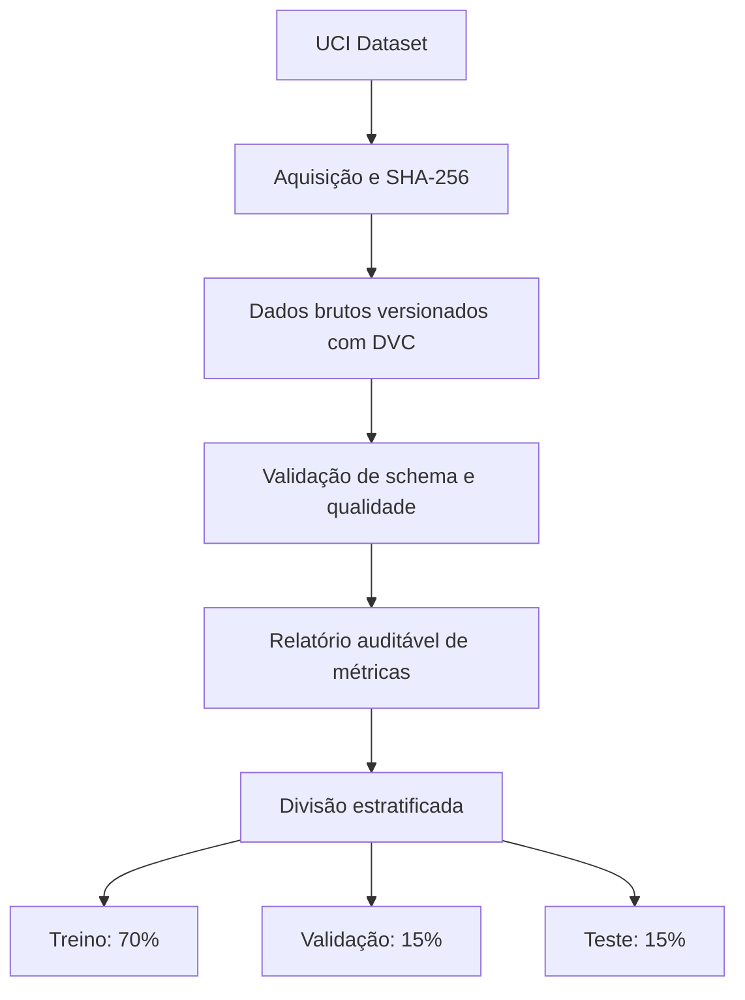

# E-commerce Purchase Propensity MLOps

Pipeline de Machine Learning para estimar a probabilidade de uma sessão de e-commerce resultar em compra, utilizando dados comportamentais de navegação.

O projeto aplica práticas de Engenharia de Machine Learning para construir uma solução reproduzível, auditável, testável e preparada para evolução até produção.

## Identificação

- **Instituição:** FIAP
- **Curso:** Pós-Tech Machine Learning Engineering
- **Tech Challenge:** Fase 2
- **Grupo:** 24
- **Autora:** Bianca Firmino Ferreira de Sena
- **Repositório:** `ecommerce-purchase-propensity-mlops`

## Problema de negócio

Uma empresa de e-commerce precisa identificar quais sessões de navegação apresentam maior propensão de compra.

A previsão pode apoiar:

- priorização de campanhas e ofertas;
- personalização da experiência;
- redução de abordagens pouco eficientes;
- melhor utilização do orçamento de marketing;
- definição de thresholds alinhados ao valor de negócio.

O projeto trata o problema como uma classificação binária:

- `Revenue = True`: a sessão terminou em compra;
- `Revenue = False`: a sessão não terminou em compra.

## Objetivos técnicos

A solução está sendo desenvolvida com foco em:

- código modular e tipado;
- prevenção de vazamento de dados;
- gerenciamento de dependências com Poetry;
- versionamento de dados e pipelines com DVC;
- validação de dados com Pandera;
- experimentos e métricas rastreados com MLflow;
- registro e promoção de modelos;
- testes automatizados;
- containerização com Docker;
- API de inferência com FastAPI;
- monitoramento e análise de drift;
- decisões de classificação orientadas ao negócio.

## Dataset

O projeto utiliza o [Online Shoppers Purchasing Intention Dataset](https://archive.ics.uci.edu/dataset/468/online+shoppers+purchasing+intention+dataset), disponibilizado pelo UCI Machine Learning Repository.

Principais características:

| Característica | Valor |
|---|---:|
| Registros | 12.330 |
| Variáveis preditoras | 17 |
| Variável-alvo | `Revenue` |
| Sessões sem compra | 10.422 |
| Sessões com compra | 1.908 |
| Taxa de compra | 15,47% |
| Valores ausentes | 0 |

O desbalanceamento da variável-alvo será considerado na escolha das métricas, na comparação dos modelos e na definição do threshold de decisão.

### Integridade dos dados

O arquivo original é validado por SHA-256:

```text
b3055ee355f59134d851d32641183cb4a8b45def7124d2f50442a042f358e0d9
```

A aquisição automatizada rejeita arquivos alterados ou incompatíveis com o conteúdo oficial esperado.

## Arquitetura atual do pipeline



A separação é determinística, utiliza a semente `42` e preserva a proporção da classe positiva:

| Partição | Registros | Taxa de compra |
|---|---:|---:|
| Treino | 8.631 | 15,48% |
| Validação | 1.849 | 15,47% |
| Teste | 1.850 | 15,46% |

O conjunto de teste permanece isolado das decisões de treinamento e seleção de modelos.

## Pipeline DVC

O pipeline implementado atualmente contém as etapas:

1. `validate_data`
   - valida schema, tipos, domínios e integridade;
   - verifica quantidade de registros e classes;
   - gera um relatório JSON auditável.

2. `preprocess`
   - lê os parâmetros de `params.yaml`;
   - realiza divisão estratificada e determinística;
   - produz arquivos Parquet para treino, validação e teste.

Visualize o pipeline:

```bash
poetry run dvc dag
```

Reproduza as etapas:

```bash
poetry run dvc repro
```

Consulte o estado:

```bash
poetry run dvc status
```

Consulte as métricas de qualidade:

```bash
poetry run dvc metrics show
```

## Estrutura do projeto

```text
.
├── .github/
│   └── workflows/
├── configs/
├── data/
│   ├── raw/
│   ├── interim/
│   └── processed/
├── docs/
│   └── decisions/
├── models/
├── notebooks/
├── reports/
│   ├── figures/
│   └── metrics/
├── src/
│   └── purchase_propensity/
│       ├── api/
│       ├── data/
│       ├── features/
│       ├── modeling/
│       ├── pipelines/
│       └── config.py
├── tests/
│   ├── fixtures/
│   ├── integration/
│   └── unit/
├── dvc.yaml
├── params.yaml
├── poetry.lock
└── pyproject.toml

```

## Requisitos

- Python 3.11
- Poetry 2.x
- Git
- Docker
- DVC instalado pelo ambiente Poetry

## Instalação

Clone o repositório:

```bash
git clone https://github.com/biancafsena/ecommerce-purchase-propensity-mlops.git
cd ecommerce-purchase-propensity-mlops
```

Configure o ambiente virtual dentro do projeto:

```bash
poetry config virtualenvs.in-project true --local
poetry env use python3.11
```

Instale as dependências:

```bash
poetry install
```

Confirme o ambiente:

```bash
poetry run python --version
poetry check
```

## Aquisição dos dados

Baixe e valide o dataset oficial:

```bash
poetry run python -m purchase_propensity.data.download
```

Para substituir e verificar novamente um arquivo já existente:

```bash
poetry run python -m purchase_propensity.data.download --force
```

O arquivo CSV é mantido fora do Git e controlado pelo DVC.

## Validação dos dados

Execute a validação manual:

```bash
poetry run python -m purchase_propensity.data.validate
```

O relatório é gerado em:

```text
reports/metrics/raw_data_validation.json
```

As validações incluem:

- nomes e ordem das colunas;
- tipos de dados;
- domínios categóricos;
- intervalos numéricos;
- ausência de valores nulos;
- quantidade esperada de registros;
- presença das duas classes;
- checksum do dataset.

## Pré-processamento

Execute a divisão dos dados:

```bash
poetry run python -m purchase_propensity.data.preprocess
```

Arquivos produzidos:

```text
data/processed/train.parquet
data/processed/validation.parquet
data/processed/test.parquet
```

As proporções e a semente são controladas em `params.yaml`.

## Qualidade de código

Formatação:

```bash
poetry run ruff format src tests
```

Análise estática:

```bash
poetry run ruff check src tests
```

Verificação de tipos:

```bash
poetry run mypy src
```

Testes e cobertura:

```bash
poetry run pytest
```

Execução completa dos hooks:

```bash
poetry run pre-commit run --all-files
```

Na etapa estável de pré-processamento, o projeto alcançou:

- 24 testes automatizados aprovados;
- 88,02% de cobertura total;
- cobertura mínima obrigatória de 80%;
- Ruff e Mypy aprovados.

## Tecnologias

- Python 3.11
- Scikit-Learn
- Pandas
- NumPy
- Pandera
- MLflow
- DVC
- Poetry
- Pytest
- Ruff
- Mypy
- FastAPI
- Docker

## Princípios adotados

- Reprodutibilidade desde a origem dos dados.
- Separação clara de responsabilidades.
- Parâmetros fora do código.
- Prevenção de vazamento entre treino, validação e teste.
- Métricas adequadas ao desbalanceamento.
- Dados pesados fora do Git.
- Rastreabilidade entre dados, código, parâmetros, experimentos e modelos.
- Validação antes do processamento.
- Testes automatizados como requisito de entrega.

## Status e roadmap

### Implementado

- [x] Estrutura modular do projeto
- [x] Ambiente Poetry e lock file
- [x] Configuração de qualidade e testes
- [x] Hooks de pre-commit e pre-push
- [x] Aquisição automatizada do dataset
- [x] Verificação de integridade por SHA-256
- [x] Versionamento do dataset bruto com DVC
- [x] Validação de schema com Pandera
- [x] Relatório auditável de qualidade
- [x] Pipeline DVC de validação
- [x] Divisão estratificada e reproduzível
- [x] Dados processados em formato Parquet
- [x] Testes unitários das etapas de dados

### Em desenvolvimento

- [ ] Pipeline de engenharia de atributos
- [ ] Treinamento de modelos baseline
- [ ] Comparação entre modelos
- [ ] Calibração de probabilidades
- [ ] Seleção de threshold orientada ao negócio
- [ ] Rastreamento de experimentos com MLflow
- [ ] MLflow Model Registry
- [ ] API de inferência com FastAPI
- [ ] Containerização com Docker
- [ ] Testes de integração
- [ ] CI com GitHub Actions
- [ ] Monitoramento e simulação de drift
- [ ] Documentação das decisões arquiteturais

## Autora

**Bianca Firmino Ferreira de Sena**

Grupo 24 — Pós-Tech Machine Learning Engineering — FIAP.
